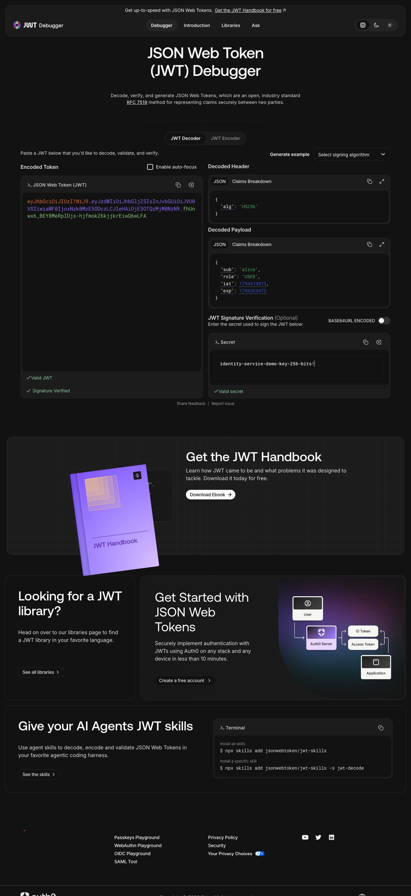

# Identity Service

Spring Boot 3 / Java 21 / Gradle service for user registration with BCrypt password hashing.

## Run

1. Create PostgreSQL database: `CREATE DATABASE identity_db;`
2. Set `DB_URL`, `DB_USERNAME`, and `DB_PASSWORD` if the defaults in `application.properties` do not match your local database.
3. Run `./gradlew bootRun`.

## Register

```bash
curl -i -X POST http://localhost:8080/api/auth/register \
  -H 'Content-Type: application/json' \
  -d '{"username":"alice","password":"secret123"}'
```

The response has status 201 and contains `id`, `username`, and `role` only. Duplicate usernames return 409. Check the database with `SELECT username, password FROM users;`; `password` contains a BCrypt hash, never the original value.

## Bài 2: JWT

`GET /api/auth/test-token?username=alice` finds the registered user in PostgreSQL and returns an HS256 JWT as plain text. Unknown usernames return 404. This exercise endpoint is public for demonstration only.

```bash
curl 'http://localhost:8080/api/auth/test-token?username=alice'
./gradlew test
```

Configuration is in `src/main/resources/application.yml`: `jwt-secret` is a development key (override with `JWT_SECRET`), and `jwt-expiration` is 3600000 ms. Claims include `sub` (username), `role`, `iat`, and `exp`.

### jwt.io verification

The screenshot below uses a synthetic user from `JwtUtilTest`, not a live database account. The test verifies the signature, username, role, and one-hour expiry. To reproduce using PostgreSQL, register alice with the command above, call test-token, and paste the returned token into jwt.io. The displayed development signing key must never be used in production.


